# Haros Human Resource Management Information Suite (HRMIS)
## STEP 2: Database Architecture, ERD & Data Schema Specification

---

### Document Information
- **Database Engine:** SQLite 3.45+ (System.Data.Sqlite / Microsoft.Data.Sqlite)
- **Target File Path:** `%ProgramData%\HarosHRMIS\Data\hrmis.db`
- **Execution Mode:** Write-Ahead Logging (`PRAGMA journal_mode=WAL; PRAGMA foreign_keys=ON;`)
- **Engineering Phase:** Step 2: Relational Database Architecture, ERD, Constraints & Migration Strategy

---

## 1. Entity Relationship Diagram (ERD)

```mermaid
erDiagram
    %% Core Employee Aggregates
    EMPLOYEE ||--|| EMPLOYEE_PERSONAL_INFO : has
    EMPLOYEE ||--|| EMPLOYEE_EMPLOYMENT_INFO : holds
    EMPLOYEE ||--o{ EMPLOYEE_QUALIFICATION : achieves
    EMPLOYEE ||--o{ EMPLOYEE_MEMBERSHIP : maintains
    EMPLOYEE ||--o{ EMPLOYEE_DOCUMENT : owns
    EMPLOYEE ||--o{ PRIOR_EMPLOYMENT_HISTORY : recorded_prior

    %% Organizational Hierarchy
    MDA ||--o{ DEPARTMENT : contains
    DEPARTMENT ||--o{ UNIT : contains
    DEPARTMENT ||--o{ ESTABLISHMENT_POSITION : allocates
    DEPARTMENT ||--o{ EMPLOYEE_EMPLOYMENT_INFO : employs

    %% Staff Movement & Career History (Immutable Core)
    EMPLOYEE ||--o{ STAFF_MOVEMENT : undertakes
    STAFF_MOVEMENT ||--o{ STAFF_MOVEMENT_HISTORY : logs_immutable
    EMPLOYEE ||--o{ PROMOTION_RECORD : receives
    GRADE_LEVEL ||--o{ PROMOTION_ELIGIBILITY_RULE : governs
    GRADE_LEVEL ||--o{ ESTABLISHMENT_POSITION : classifies
    SALARY_STRUCTURE ||--o{ SALARY_STEP : details

    %% Operational Services
    EMPLOYEE ||--o{ LEAVE_APPLICATION : applies
    LEAVE_TYPE ||--o{ LEAVE_APPLICATION : categorizes
    EMPLOYEE ||--o{ LEAVE_BALANCE : accumulates
    LEAVE_TYPE ||--o{ LEAVE_BALANCE : allocates
    EMPLOYEE ||--o{ ATTENDANCE_RECORD : logs
    TRAINING_PROGRAM ||--o{ TRAINING_PARTICIPANT : enrolls
    EMPLOYEE ||--o{ TRAINING_PARTICIPANT : attends
    APPRAISAL_PERIOD ||--o{ PERFORMANCE_APPRAISAL : schedules
    EMPLOYEE ||--o{ PERFORMANCE_APPRAISAL : evaluated_by

    %% Separation, Disciplinary & Establishment
    EMPLOYEE ||--o{ DISCIPLINARY_CASE : subjected_to
    EMPLOYEE ||--o| SEPARATION_RECORD : departs_via
    ESTABLISHMENT_POSITION ||--o{ EMPLOYEE_EMPLOYMENT_INFO : occupies

    %% Governance, RBAC & Audit
    USER ||--o{ USER_ROLE : assigned
    ROLE ||--o{ USER_ROLE : grants
    ROLE ||--o{ ROLE_PERMISSION : contains
    PERMISSION ||--o{ ROLE_PERMISSION : maps
    USER ||--o{ AUDIT_LOG : generates
```



---

## 2. Comprehensive Database Tables & Field Definitions

### 2.1 Core Employee Subsystem

#### Table: `Employees`
Central master employee table.
```sql
CREATE TABLE Employees (
    Id INTEGER PRIMARY KEY AUTOINCREMENT,
    StaffId TEXT NOT NULL COLLATE NOCASE,           -- Globally unique institutional Staff ID (e.g. MDA-EMP-00104)
    IsActive INTEGER NOT NULL DEFAULT 1,             -- 1 = Active, 0 = Inactive/Separated/Suspended
    IsDeleted INTEGER NOT NULL DEFAULT 0,            -- Soft-delete flag (Never purge civil service records)
    CreatedDate TEXT NOT NULL,                       -- ISO-8601 UTC string (e.g. 2026-11-07T22:30:00Z)
    CreatedBy TEXT NOT NULL,
    ModifiedDate TEXT NOT NULL,
    ModifiedBy TEXT NOT NULL,
    CONSTRAINT UQ_Employees_StaffId UNIQUE (StaffId)
);
```

#### Table: `EmployeePersonalInfo`
Detailed biographical and personal information.
```sql
CREATE TABLE EmployeePersonalInfo (
    Id INTEGER PRIMARY KEY AUTOINCREMENT,
    EmployeeId INTEGER NOT NULL,
    Surname TEXT NOT NULL,
    FirstName TEXT NOT NULL,
    OtherNames TEXT,
    FullName TEXT NOT NULL,                          -- Generated / Normalized full name for rapid lookup
    DateOfBirth TEXT NOT NULL,                       -- YYYY-MM-DD
    Gender TEXT NOT NULL CHECK (Gender IN ('Male', 'Female')),
    MaritalStatus TEXT NOT NULL CHECK (MaritalStatus IN ('Single', 'Married', 'Divorced', 'Widowed', 'Separated')),
    Nationality TEXT NOT NULL DEFAULT 'Ghanaian',
    ResidentialAddress TEXT NOT NULL,
    TelephoneNumber TEXT NOT NULL,
    EmailAddress TEXT,
    EmergencyContactName TEXT NOT NULL,
    EmergencyContactPhone TEXT NOT NULL,
    NextOfKinName TEXT NOT NULL,
    NextOfKinRelationship TEXT NOT NULL,
    NextOfKinPhone TEXT NOT NULL,
    NextOfKinAddress TEXT,
    PhotoFilePath TEXT,                             -- Relative path under %ProgramData%\HarosHRMIS\Documents\{StaffId}\photo.jpg
    CONSTRAINT FK_EmployeePersonalInfo_Employee FOREIGN KEY (EmployeeId) 
        REFERENCES Employees (Id) ON DELETE RESTRICT
);
```

#### Table: `EmployeeEmploymentInfo`
Active employment status and organizational placement. Automatically synchronized with approved staff movements.
```sql
CREATE TABLE EmployeeEmploymentInfo (
    Id INTEGER PRIMARY KEY AUTOINCREMENT,
    EmployeeId INTEGER NOT NULL,
    EmployeeCategory TEXT NOT NULL CHECK (EmployeeCategory IN ('Professional', 'Sub-Professional', 'Technical', 'Administrative', 'Consultant')), -- Civil Service Cadre Class: Professional vs. Sub-Professional
    EmploymentType TEXT NOT NULL,                    -- 'Permanent & Pensionable', 'Fixed-Term Contract', 'Casual'
    DateOfFirstAppointment TEXT NOT NULL,            -- YYYY-MM-DD
    DateOfAssumptionOfDuty TEXT NOT NULL,            -- YYYY-MM-DD
    EmploymentConfirmationDate TEXT,                 -- Date probation completed
    StatutoryRetirementDate TEXT NOT NULL,           -- Computed: MIN(DOB + 60 years, DateOfFirstAppointment + 35 years)
    CurrentEmploymentStatus TEXT NOT NULL DEFAULT 'Active' 
        CHECK (CurrentEmploymentStatus IN ('Active', 'On Probation', 'On Secondment', 'On Study Leave', 'Interdicted', 'Suspended', 'Separated', 'Retired')),
    CurrentMdaId INTEGER NOT NULL,
    CurrentDepartmentId INTEGER NOT NULL,
    CurrentUnitId INTEGER,
    CurrentPositionTitle TEXT NOT NULL,
    CurrentGradeId INTEGER NOT NULL,
    CurrentSalaryLevel INTEGER NOT NULL DEFAULT 1,
    CurrentSalaryStep INTEGER NOT NULL DEFAULT 1,
    ReportingOfficerEmployeeId INTEGER,             -- Self-referential FK to Supervisor
    DateAssignedCurrentRole TEXT NOT NULL,           -- Date of latest movement into current role
    DateAssignedCurrentGrade TEXT NOT NULL,          -- Date of latest promotion / grade placement
    CONSTRAINT FK_EmployeeEmploymentInfo_Employee FOREIGN KEY (EmployeeId) 
        REFERENCES Employees (Id) ON DELETE RESTRICT,
    CONSTRAINT FK_EmployeeEmploymentInfo_MDA FOREIGN KEY (CurrentMdaId) 
        REFERENCES Mdas (Id) ON DELETE RESTRICT,
    CONSTRAINT FK_EmployeeEmploymentInfo_Department FOREIGN KEY (CurrentDepartmentId) 
        REFERENCES Departments (Id) ON DELETE RESTRICT,
    CONSTRAINT FK_EmployeeEmploymentInfo_Unit FOREIGN KEY (CurrentUnitId) 
        REFERENCES Units (Id) ON DELETE SET NULL,
    CONSTRAINT FK_EmployeeEmploymentInfo_Grade FOREIGN KEY (CurrentGradeId) 
        REFERENCES GradeLevels (Id) ON DELETE RESTRICT,
    CONSTRAINT FK_EmployeeEmploymentInfo_Supervisor FOREIGN KEY (ReportingOfficerEmployeeId) 
        REFERENCES Employees (Id) ON DELETE SET NULL
);
```

#### Table: `EmployeeQualifications`
```sql
CREATE TABLE EmployeeQualifications (
    Id INTEGER PRIMARY KEY AUTOINCREMENT,
    EmployeeId INTEGER NOT NULL,
    QualificationLevel TEXT NOT NULL,                -- 'WASSCE', 'Diploma', 'HND', 'Bachelor', 'Master', 'Doctorate', 'Professional'
    QualificationTitle TEXT NOT NULL,
    InstitutionName TEXT NOT NULL,
    Country TEXT NOT NULL DEFAULT 'Ghana',
    CourseOfStudy TEXT NOT NULL,
    YearObtained INTEGER NOT NULL CHECK (YearObtained BETWEEN 1950 AND 2100),
    CertificateNumber TEXT,
    SupportingDocumentPath TEXT,
    VerificationStatus TEXT NOT NULL DEFAULT 'Verified' CHECK (VerificationStatus IN ('Pending', 'Verified', 'Rejected')),
    CONSTRAINT FK_EmployeeQualifications_Employee FOREIGN KEY (EmployeeId) 
        REFERENCES Employees (Id) ON DELETE CASCADE
);
```

#### Table: `EmployeeProfessionalMemberships`
```sql
CREATE TABLE EmployeeProfessionalMemberships (
    Id INTEGER PRIMARY KEY AUTOINCREMENT,
    EmployeeId INTEGER NOT NULL,
    ProfessionalBody TEXT NOT NULL,                  -- e.g. 'Ghana Institution of Engineering (GhIE)', 'ICAG'
    MembershipNumber TEXT NOT NULL,
    MembershipCategory TEXT NOT NULL,                -- 'Associate', 'Full Member', 'Fellow', 'Chartered'
    RegistrationDate TEXT NOT NULL,
    ExpiryDate TEXT,
    MembershipStatus TEXT NOT NULL DEFAULT 'Active' CHECK (MembershipStatus IN ('Active', 'Lapsed', 'Suspended')),
    CONSTRAINT FK_EmployeeMemberships_Employee FOREIGN KEY (EmployeeId) 
        REFERENCES Employees (Id) ON DELETE CASCADE
);
```

#### Table: `PriorEmploymentHistory`
Records career milestones prior to entering current civil service cadre.
```sql
CREATE TABLE PriorEmploymentHistory (
    Id INTEGER PRIMARY KEY AUTOINCREMENT,
    EmployeeId INTEGER NOT NULL,
    OrganizationName TEXT NOT NULL,
    PositionTitle TEXT NOT NULL,
    GradeRank TEXT,
    StartDate TEXT NOT NULL,
    EndDate TEXT NOT NULL,
    ReasonForLeaving TEXT,
    CONSTRAINT FK_PriorEmploymentHistory_Employee FOREIGN KEY (EmployeeId) 
        REFERENCES Employees (Id) ON DELETE CASCADE
);
```

#### Table: `EmployeeDocuments`
```sql
CREATE TABLE EmployeeDocuments (
    Id INTEGER PRIMARY KEY AUTOINCREMENT,
    EmployeeId INTEGER NOT NULL,
    DocumentCategory TEXT NOT NULL,                  -- 'Appointment Letter', 'Promotion Letter', 'Transfer Letter', 'Academic Certificate', 'Appraisal', 'Medical'
    DocumentTitle TEXT NOT NULL,
    FileName TEXT NOT NULL,
    FileExtension TEXT NOT NULL,
    FileSizeInBytes INTEGER NOT NULL,
    RelativeFilePath TEXT NOT NULL,
    UploadedBy TEXT NOT NULL,
    UploadTimestamp TEXT NOT NULL,
    Sha256Checksum TEXT NOT NULL,
    CONSTRAINT FK_EmployeeDocuments_Employee FOREIGN KEY (EmployeeId) 
        REFERENCES Employees (Id) ON DELETE RESTRICT
);
```

---

### 2.2 Organizational Structure & Establishment

#### Table: `Mdas`
Ministries, Departments, and Agencies root entities.
```sql
CREATE TABLE Mdas (
    Id INTEGER PRIMARY KEY AUTOINCREMENT,
    Code TEXT NOT NULL COLLATE NOCASE,               -- e.g. 'OHCS', 'MOF', 'MLNR'
    Name TEXT NOT NULL,
    MdaType TEXT NOT NULL CHECK (MdaType IN ('Ministry', 'Department', 'Agency', 'Commission')),
    HeadEmployeeId INTEGER,
    IsActive INTEGER NOT NULL DEFAULT 1,
    CONSTRAINT UQ_Mdas_Code UNIQUE (Code),
    CONSTRAINT FK_Mdas_Head FOREIGN KEY (HeadEmployeeId) 
        REFERENCES Employees (Id) ON DELETE SET NULL
);
```

#### Table: `Departments`
```sql
CREATE TABLE Departments (
    Id INTEGER PRIMARY KEY AUTOINCREMENT,
    MdaId INTEGER NOT NULL,
    DepartmentCode TEXT NOT NULL COLLATE NOCASE,     -- e.g. 'HRM', 'F&A', 'RSIM'
    DepartmentName TEXT NOT NULL,
    ParentDepartmentId INTEGER,                      -- Hierarchical self-join
    DepartmentHeadEmployeeId INTEGER,
    Status TEXT NOT NULL DEFAULT 'Active' CHECK (Status IN ('Active', 'Archived')),
    CONSTRAINT UQ_Departments_Code UNIQUE (MdaId, DepartmentCode),
    CONSTRAINT FK_Departments_Mda FOREIGN KEY (MdaId) 
        REFERENCES Mdas (Id) ON DELETE RESTRICT,
    CONSTRAINT FK_Departments_Parent FOREIGN KEY (ParentDepartmentId) 
        REFERENCES Departments (Id) ON DELETE RESTRICT,
    CONSTRAINT FK_Departments_Head FOREIGN KEY (DepartmentHeadEmployeeId) 
        REFERENCES Employees (Id) ON DELETE SET NULL
);
```

#### Table: `Units`
```sql
CREATE TABLE Units (
    Id INTEGER PRIMARY KEY AUTOINCREMENT,
    DepartmentId INTEGER NOT NULL,
    UnitCode TEXT NOT NULL,
    UnitName TEXT NOT NULL,
    UnitHeadEmployeeId INTEGER,
    CONSTRAINT UQ_Units_Code UNIQUE (DepartmentId, UnitCode),
    CONSTRAINT FK_Units_Department FOREIGN KEY (DepartmentId) 
        REFERENCES Departments (Id) ON DELETE CASCADE,
    CONSTRAINT FK_Units_Head FOREIGN KEY (UnitHeadEmployeeId) 
        REFERENCES Employees (Id) ON DELETE SET NULL
);
```

#### Table: `GradeLevels`
Standardized civil service grade levels.
```sql
CREATE TABLE GradeLevels (
    Id INTEGER PRIMARY KEY AUTOINCREMENT,
    GradeCode TEXT NOT NULL UNIQUE,                  -- e.g. 'L14', 'L15', 'L16', 'L17'
    GradeName TEXT NOT NULL,                         -- e.g. 'Assistant Director II', 'Assistant Director I', 'Director'
    HierarchyRank INTEGER NOT NULL UNIQUE,          -- Order of precedence: 1 (Entry level) to 25 (Chief Director)
    MinYearsInGradeForPromotion INTEGER NOT NULL DEFAULT 3,
    IsActive INTEGER NOT NULL DEFAULT 1
);
```

#### Table: `EstablishmentPositions`
Governs authorized cadre vs. occupied headcount.
```sql
CREATE TABLE EstablishmentPositions (
    Id INTEGER PRIMARY KEY AUTOINCREMENT,
    PositionCode TEXT NOT NULL UNIQUE,               -- e.g. 'EST-MOF-HR-001'
    DepartmentId INTEGER NOT NULL,
    GradeId INTEGER NOT NULL,
    PositionTitle TEXT NOT NULL,
    ApprovedCadreQuota INTEGER NOT NULL DEFAULT 1 CHECK (ApprovedCadreQuota >= 0),
    Status TEXT NOT NULL DEFAULT 'Active' CHECK (Status IN ('Active', 'Frozen', 'Abolished')),
    CONSTRAINT FK_EstablishmentPositions_Dept FOREIGN KEY (DepartmentId) 
        REFERENCES Departments (Id) ON DELETE RESTRICT,
    CONSTRAINT FK_EstablishmentPositions_Grade FOREIGN KEY (GradeId) 
        REFERENCES GradeLevels (Id) ON DELETE RESTRICT
);
```

---

### 2.3 Staff Movements & Historical Ledgers (Zero-Overwrite Core)

#### Table: `StaffMovements`
Working transactional entity for movement processing.
```sql
CREATE TABLE StaffMovements (
    Id INTEGER PRIMARY KEY AUTOINCREMENT,
    MovementReferenceNumber TEXT NOT NULL UNIQUE,    -- e.g. 'MOV-2026-00481'
    EmployeeId INTEGER NOT NULL,
    MovementType TEXT NOT NULL CHECK (MovementType IN (
        'Transfer', 'Posting', 'Secondment', 'Acting Appointment', 
        'Reassignment', 'Redeployment', 'Promotion', 'Demotion', 
        'Interdepartmental Movement', 'Inter-MDA Movement', 
        'Return from Secondment', 'Temporary Assignment'
    )),
    
    -- Origin Placement State
    PreviousMdaId INTEGER NOT NULL,
    PreviousDepartmentId INTEGER NOT NULL,
    PreviousUnitId INTEGER,
    PreviousPositionTitle TEXT NOT NULL,
    PreviousGradeId INTEGER NOT NULL,
    PreviousSalaryLevel INTEGER NOT NULL,
    PreviousSalaryStep INTEGER NOT NULL,
    
    -- Destination Placement State
    NewMdaId INTEGER NOT NULL,
    NewDepartmentId INTEGER NOT NULL,
    NewUnitId INTEGER,
    NewPositionTitle TEXT NOT NULL,
    NewGradeId INTEGER NOT NULL,
    NewSalaryLevel INTEGER NOT NULL,
    NewSalaryStep INTEGER NOT NULL,
    
    -- Workflow Metadata
    EffectiveDate TEXT NOT NULL,                     -- YYYY-MM-DD
    ApprovalDate TEXT,
    ImplementationDate TEXT,
    MovementReason TEXT NOT NULL,
    ApprovedByUserId INTEGER,
    SupportingDocumentPath TEXT,
    Remarks TEXT,
    WorkflowStatus TEXT NOT NULL DEFAULT 'Draft' 
        CHECK (WorkflowStatus IN ('Draft', 'Submitted', 'Under Review', 'Approved', 'Implemented', 'Rejected', 'Cancelled')),
    
    CreatedTimestamp TEXT NOT NULL,
    CreatedBy TEXT NOT NULL,
    
    CONSTRAINT FK_StaffMovements_Employee FOREIGN KEY (EmployeeId) 
        REFERENCES Employees (Id) ON DELETE RESTRICT,
    CONSTRAINT FK_StaffMovements_PrevMda FOREIGN KEY (PreviousMdaId) 
        REFERENCES Mdas (Id) ON DELETE RESTRICT,
    CONSTRAINT FK_StaffMovements_NewMda FOREIGN KEY (NewMdaId) 
        REFERENCES Mdas (Id) ON DELETE RESTRICT,
    CONSTRAINT FK_StaffMovements_PrevDept FOREIGN KEY (PreviousDepartmentId) 
        REFERENCES Departments (Id) ON DELETE RESTRICT,
    CONSTRAINT FK_StaffMovements_NewDept FOREIGN KEY (NewDepartmentId) 
        REFERENCES Departments (Id) ON DELETE RESTRICT,
    CONSTRAINT FK_StaffMovements_PrevGrade FOREIGN KEY (PreviousGradeId) 
        REFERENCES GradeLevels (Id) ON DELETE RESTRICT,
    CONSTRAINT FK_StaffMovements_NewGrade FOREIGN KEY (NewGradeId) 
        REFERENCES GradeLevels (Id) ON DELETE RESTRICT,
    CONSTRAINT FK_StaffMovements_Approver FOREIGN KEY (ApprovedByUserId) 
        REFERENCES Users (Id) ON DELETE RESTRICT
);
```

#### Table: `StaffMovementHistory`
**Immutable Ledger.** Written strictly when a `StaffMovement` achieves `Implemented` status. Never updated, never deleted.
```sql
CREATE TABLE StaffMovementHistory (
    Id INTEGER PRIMARY KEY AUTOINCREMENT,
    MovementId INTEGER NOT NULL,
    EmployeeId INTEGER NOT NULL,
    MovementReferenceNumber TEXT NOT NULL,
    MovementType TEXT NOT NULL,
    
    MdaNameFrom TEXT NOT NULL,
    MdaNameTo TEXT NOT NULL,
    DepartmentNameFrom TEXT NOT NULL,
    DepartmentNameTo TEXT NOT NULL,
    UnitNameFrom TEXT,
    UnitNameTo TEXT,
    PositionTitleFrom TEXT NOT NULL,
    PositionTitleTo TEXT NOT NULL,
    GradeCodeFrom TEXT NOT NULL,
    GradeCodeTo TEXT NOT NULL,
    
    EffectiveDate TEXT NOT NULL,
    ApprovalDate TEXT NOT NULL,
    ImplementedDate TEXT NOT NULL,
    ApprovedByOfficerName TEXT NOT NULL,
    Reason TEXT NOT NULL,
    SupportingDocumentReference TEXT,
    ArchivedSnapshotJson TEXT NOT NULL,              -- Full JSON dump of pre-movement state
    RecordedTimestamp TEXT NOT NULL,
    
    CONSTRAINT FK_MovementHistory_Movement FOREIGN KEY (MovementId) 
        REFERENCES StaffMovements (Id) ON DELETE RESTRICT,
    CONSTRAINT FK_MovementHistory_Employee FOREIGN KEY (EmployeeId) 
        REFERENCES Employees (Id) ON DELETE RESTRICT
);
```

---

### 2.4 Promotion, Recruitment & Career Progression

#### Table: `PromotionRecords`
```sql
CREATE TABLE PromotionRecords (
    Id INTEGER PRIMARY KEY AUTOINCREMENT,
    PromotionReferenceNumber TEXT NOT NULL UNIQUE,   -- e.g. 'PROM-2026-0012'
    EmployeeId INTEGER NOT NULL,
    PreviousGradeId INTEGER NOT NULL,
    NewGradeId INTEGER NOT NULL,
    PreviousSalaryStep INTEGER NOT NULL,
    NewSalaryStep INTEGER NOT NULL,
    YearsInPreviousGrade REAL NOT NULL,
    InterviewScore REAL,
    AppraisalScoreAverage REAL,
    EffectiveDate TEXT NOT NULL,
    ApprovalDate TEXT NOT NULL,
    ApprovedByUserId INTEGER NOT NULL,
    PromotionLetterDocumentPath TEXT,
    Status TEXT NOT NULL DEFAULT 'Approved' CHECK (Status IN ('Pending', 'Approved', 'Implemented', 'Revoked')),
    CONSTRAINT FK_Promotion_Employee FOREIGN KEY (EmployeeId) 
        REFERENCES Employees (Id) ON DELETE RESTRICT,
    CONSTRAINT FK_Promotion_PrevGrade FOREIGN KEY (PreviousGradeId) 
        REFERENCES GradeLevels (Id) ON DELETE RESTRICT,
    CONSTRAINT FK_Promotion_NewGrade FOREIGN KEY (NewGradeId) 
        REFERENCES GradeLevels (Id) ON DELETE RESTRICT,
    CONSTRAINT FK_Promotion_Approver FOREIGN KEY (ApprovedByUserId) 
        REFERENCES Users (Id) ON DELETE RESTRICT
);
```

#### Table: `PromotionEligibilityRules`
```sql
CREATE TABLE PromotionEligibilityRules (
    Id INTEGER PRIMARY KEY AUTOINCREMENT,
    FromGradeId INTEGER NOT NULL,
    ToGradeId INTEGER NOT NULL,
    RequiredMinimumYearsInGrade INTEGER NOT NULL DEFAULT 3,
    RequiredMinimumAppraisalRating REAL NOT NULL DEFAULT 3.5, -- out of 5.0
    RequiresInterview INTEGER NOT NULL DEFAULT 1,
    IsActive INTEGER NOT NULL DEFAULT 1,
    CONSTRAINT FK_PromotionRules_FromGrade FOREIGN KEY (FromGradeId) REFERENCES GradeLevels (Id),
    CONSTRAINT FK_PromotionRules_ToGrade FOREIGN KEY (ToGradeId) REFERENCES GradeLevels (Id)
);
```

#### Table: `RecruitmentVacancies`
```sql
CREATE TABLE RecruitmentVacancies (
    Id INTEGER PRIMARY KEY AUTOINCREMENT,
    VacancyReferenceNumber TEXT NOT NULL UNIQUE,
    EstablishmentPositionId INTEGER NOT NULL,
    NumberOfSlots INTEGER NOT NULL DEFAULT 1,
    OpeningDate TEXT NOT NULL,
    ClosingDate TEXT NOT NULL,
    Status TEXT NOT NULL DEFAULT 'Open' CHECK (Status IN ('Draft', 'Open', 'Shortlisting', 'Interviewing', 'Closed')),
    CONSTRAINT FK_Vacancies_Position FOREIGN KEY (EstablishmentPositionId) 
        REFERENCES EstablishmentPositions (Id) ON DELETE RESTRICT
);
```

#### Table: `RecruitmentApplicants`
```sql
CREATE TABLE RecruitmentApplicants (
    Id INTEGER PRIMARY KEY AUTOINCREMENT,
    VacancyId INTEGER NOT NULL,
    ApplicantReferenceNumber TEXT NOT NULL UNIQUE,
    FullName TEXT NOT NULL,
    DateOfBirth TEXT NOT NULL,
    Gender TEXT NOT NULL,
    ContactPhone TEXT NOT NULL,
    EmailAddress TEXT NOT NULL,
    HighestQualification TEXT NOT NULL,
    YearsOfExperience INTEGER NOT NULL,
    InterviewScore REAL,
    SelectionStatus TEXT NOT NULL DEFAULT 'Applied' 
        CHECK (SelectionStatus IN ('Applied', 'Shortlisted', 'Interviewed', 'Recommended', 'Offered', 'Appointed', 'Rejected')),
    AppointmentDate TEXT,
    ConvertedStaffId TEXT,                           -- Populated when onboarded into Employees
    CONSTRAINT FK_Applicants_Vacancy FOREIGN KEY (VacancyId) 
        REFERENCES RecruitmentVacancies (Id) ON DELETE RESTRICT
);
```

---

### 2.5 Operational Employee Services (Leave, Attendance, Training, Performance)

#### Table: `LeaveTypes`
```sql
CREATE TABLE LeaveTypes (
    Id INTEGER PRIMARY KEY AUTOINCREMENT,
    LeaveCode TEXT NOT NULL UNIQUE,                  -- 'ANNUAL', 'SICK', 'MATERNITY', 'PATERNITY', 'STUDY'
    LeaveName TEXT NOT NULL,
    DefaultDaysPerYear INTEGER NOT NULL,
    IsPaid INTEGER NOT NULL DEFAULT 1,
    CanCarryForward INTEGER NOT NULL DEFAULT 0,
    MaxCarryForwardDays INTEGER NOT NULL DEFAULT 0,
    GenderApplicability TEXT NOT NULL DEFAULT 'All' CHECK (GenderApplicability IN ('All', 'Male', 'Female')),
    RequiresMedicalCertificate INTEGER NOT NULL DEFAULT 0
);
```

#### Table: `LeaveBalances`
```sql
CREATE TABLE LeaveBalances (
    Id INTEGER PRIMARY KEY AUTOINCREMENT,
    EmployeeId INTEGER NOT NULL,
    LeaveTypeId INTEGER NOT NULL,
    CalendarYear INTEGER NOT NULL,
    AnnualEntitlementDays INTEGER NOT NULL,
    BroughtForwardDays INTEGER NOT NULL DEFAULT 0,
    DaysTaken INTEGER NOT NULL DEFAULT 0,
    AvailableDays INTEGER NOT NULL,
    CONSTRAINT UQ_LeaveBalances UNIQUE (EmployeeId, LeaveTypeId, CalendarYear),
    CONSTRAINT FK_LeaveBalances_Employee FOREIGN KEY (EmployeeId) REFERENCES Employees (Id) ON DELETE CASCADE,
    CONSTRAINT FK_LeaveBalances_Type FOREIGN KEY (LeaveTypeId) REFERENCES LeaveTypes (Id) ON DELETE RESTRICT
);
```

#### Table: `LeaveApplications`
```sql
CREATE TABLE LeaveApplications (
    Id INTEGER PRIMARY KEY AUTOINCREMENT,
    ApplicationNumber TEXT NOT NULL UNIQUE,
    EmployeeId INTEGER NOT NULL,
    LeaveTypeId INTEGER NOT NULL,
    StartDate TEXT NOT NULL,
    EndDate TEXT NOT NULL,
    TotalDaysRequested INTEGER NOT NULL,
    RelievingOfficerEmployeeId INTEGER,
    ContactAddressWhileOnLeave TEXT,
    EmergencyPhone TEXT,
    WorkflowStatus TEXT NOT NULL DEFAULT 'Applied' 
        CHECK (WorkflowStatus IN ('Applied', 'Supervisor Recommended', 'HR Approved', 'Rejected', 'Resumed', 'Cancelled')),
    SupervisorRecommendationDate TEXT,
    SupervisorComments TEXT,
    HrApprovalDate TEXT,
    HrApprovedByUserId INTEGER,
    ResumptionDate TEXT,
    CONSTRAINT FK_LeaveApp_Employee FOREIGN KEY (EmployeeId) REFERENCES Employees (Id) ON DELETE RESTRICT,
    CONSTRAINT FK_LeaveApp_Type FOREIGN KEY (LeaveTypeId) REFERENCES LeaveTypes (Id) ON DELETE RESTRICT,
    CONSTRAINT FK_LeaveApp_Reliever FOREIGN KEY (RelievingOfficerEmployeeId) REFERENCES Employees (Id) ON DELETE SET NULL,
    CONSTRAINT FK_LeaveApp_Approver FOREIGN KEY (HrApprovedByUserId) REFERENCES Users (Id) ON DELETE SET NULL
);
```

#### Table: `AttendanceRecords`
```sql
CREATE TABLE AttendanceRecords (
    Id INTEGER PRIMARY KEY AUTOINCREMENT,
    EmployeeId INTEGER NOT NULL,
    AttendanceDate TEXT NOT NULL,                    -- YYYY-MM-DD
    TimeIn TEXT,                                     -- HH:MM:SS
    TimeOut TEXT,                                    -- HH:MM:SS
    AttendanceStatus TEXT NOT NULL CHECK (AttendanceStatus IN (
        'Present', 'Absent', 'Excused', 'Late', 'Half-Day', 'Official Duty', 'On Leave'
    )),
    Remarks TEXT,
    LoggedByUserId INTEGER,
    CONSTRAINT UQ_Attendance UNIQUE (EmployeeId, AttendanceDate),
    CONSTRAINT FK_Attendance_Employee FOREIGN KEY (EmployeeId) REFERENCES Employees (Id) ON DELETE RESTRICT
);
```

#### Table: `TrainingPrograms`
```sql
CREATE TABLE TrainingPrograms (
    Id INTEGER PRIMARY KEY AUTOINCREMENT,
    ProgramCode TEXT NOT NULL UNIQUE,
    Title TEXT NOT NULL,
    TrainingCategory TEXT NOT NULL,                  -- 'Executive Leadership', 'Technical', 'Compliance', 'Financial Management'
    InstitutionName TEXT NOT NULL,
    Location TEXT NOT NULL,
    StartDate TEXT NOT NULL,
    EndDate TEXT NOT NULL,
    TotalCostInGhs REAL NOT NULL DEFAULT 0.0,
    SponsoredBy TEXT NOT NULL,                       -- 'Government of Ghana', 'Development Partner', 'Self-Sponsored'
    Status TEXT NOT NULL DEFAULT 'Scheduled' CHECK (Status IN ('Scheduled', 'In Progress', 'Completed', 'Cancelled'))
);
```

#### Table: `TrainingParticipants`
```sql
CREATE TABLE TrainingParticipants (
    Id INTEGER PRIMARY KEY AUTOINCREMENT,
    TrainingProgramId INTEGER NOT NULL,
    EmployeeId INTEGER NOT NULL,
    NominationStatus TEXT NOT NULL DEFAULT 'Nominated' CHECK (NominationStatus IN ('Nominated', 'Approved', 'Attended', 'Completed', 'Failed')),
    CertificateObtained TEXT,
    OutcomeAssessment TEXT,
    BondRequired INTEGER NOT NULL DEFAULT 0,
    BondExpiryDate TEXT,
    CONSTRAINT UQ_TrainingParticipants UNIQUE (TrainingProgramId, EmployeeId),
    CONSTRAINT FK_TrainingPart_Program FOREIGN KEY (TrainingProgramId) REFERENCES TrainingPrograms (Id) ON DELETE CASCADE,
    CONSTRAINT FK_TrainingPart_Employee FOREIGN KEY (EmployeeId) REFERENCES Employees (Id) ON DELETE RESTRICT
);
```

#### Table: `AppraisalPeriods`
```sql
CREATE TABLE AppraisalPeriods (
    Id INTEGER PRIMARY KEY AUTOINCREMENT,
    CycleYear INTEGER NOT NULL UNIQUE,               -- e.g. 2026
    CycleName TEXT NOT NULL,
    StartDate TEXT NOT NULL,
    EndDate TEXT NOT NULL,
    IsActive INTEGER NOT NULL DEFAULT 1
);
```

#### Table: `PerformanceAppraisals`
```sql
CREATE TABLE PerformanceAppraisals (
    Id INTEGER PRIMARY KEY AUTOINCREMENT,
    AppraisalPeriodId INTEGER NOT NULL,
    EmployeeId INTEGER NOT NULL,
    SupervisorEmployeeId INTEGER NOT NULL,
    SelfAppraisalScore REAL,                         -- Scale 1.0 - 5.0
    SupervisorAppraisalScore REAL,
    AgreedScore REAL,
    FinalPerformanceRating TEXT CHECK (FinalPerformanceRating IN ('Excellent', 'Very Good', 'Satisfactory', 'Needs Improvement', 'Unsatisfactory')),
    KeyAchievements TEXT,
    AreasForImprovement TEXT,
    RequiresPip INTEGER NOT NULL DEFAULT 0,          -- Performance Improvement Plan
    AppraisalStatus TEXT NOT NULL DEFAULT 'Draft' CHECK (AppraisalStatus IN ('Draft', 'Submitted', 'Evaluated', 'Completed', 'Disputed')),
    CompletedDate TEXT,
    CONSTRAINT UQ_Appraisals UNIQUE (AppraisalPeriodId, EmployeeId),
    CONSTRAINT FK_Appraisal_Period FOREIGN KEY (AppraisalPeriodId) REFERENCES AppraisalPeriods (Id) ON DELETE RESTRICT,
    CONSTRAINT FK_Appraisal_Employee FOREIGN KEY (EmployeeId) REFERENCES Employees (Id) ON DELETE RESTRICT,
    CONSTRAINT FK_Appraisal_Supervisor FOREIGN KEY (SupervisorEmployeeId) REFERENCES Employees (Id) ON DELETE RESTRICT
);
```

---

### 2.6 Compensation, Retirement & Disciplinary Cases

#### Table: `SalaryStructures`
```sql
CREATE TABLE SalaryStructures (
    Id INTEGER PRIMARY KEY AUTOINCREMENT,
    StructureName TEXT NOT NULL,                     -- e.g. 'Single Spine Salary Structure (SSSS)'
    EffectiveYear INTEGER NOT NULL,
    CurrencyCode TEXT NOT NULL DEFAULT 'GHS',
    IsCurrent INTEGER NOT NULL DEFAULT 1
);
```

#### Table: `SalarySteps`
```sql
CREATE TABLE SalarySteps (
    Id INTEGER PRIMARY KEY AUTOINCREMENT,
    SalaryStructureId INTEGER NOT NULL,
    GradeId INTEGER NOT NULL,
    StepNumber INTEGER NOT NULL CHECK (StepNumber BETWEEN 1 AND 20),
    MonthlyBasicSalaryInGhs REAL NOT NULL CHECK (MonthlyBasicSalaryInGhs >= 0),
    AnnualBasicSalaryInGhs REAL NOT NULL CHECK (AnnualBasicSalaryInGhs >= 0),
    CONSTRAINT UQ_SalaryStep UNIQUE (SalaryStructureId, GradeId, StepNumber),
    CONSTRAINT FK_SalarySteps_Structure FOREIGN KEY (SalaryStructureId) REFERENCES SalaryStructures (Id) ON DELETE CASCADE,
    CONSTRAINT FK_SalarySteps_Grade FOREIGN KEY (GradeId) REFERENCES GradeLevels (Id) ON DELETE RESTRICT
);
```

#### Table: `DisciplinaryCases`
```sql
CREATE TABLE DisciplinaryCases (
    Id INTEGER PRIMARY KEY AUTOINCREMENT,
    CaseReferenceNumber TEXT NOT NULL UNIQUE,        -- e.g. 'DISC-2026-0034'
    EmployeeId INTEGER NOT NULL,
    IncidentDate TEXT NOT NULL,
    NatureOfOffence TEXT NOT NULL,
    AllegationDetails TEXT NOT NULL,
    DisciplinaryCommitteeName TEXT,
    HearingDate TEXT,
    HearingMinutesDocumentPath TEXT,
    CommitteeFindings TEXT,
    RecommendedSanction TEXT CHECK (RecommendedSanction IN (
        'Verbal Warning', 'Written Query', 'Official Warning', 
        'Interdiction', 'Surcharge', 'Demotion', 'Suspension', 'Dismissal', 'Exonerated'
    )),
    DecisionDate TEXT,
    CaseStatus TEXT NOT NULL DEFAULT 'Under Investigation' 
        CHECK (CaseStatus IN ('Under Investigation', 'Committee Hearing', 'Pending Decision', 'Sanction Implemented', 'Closed', 'Appealed')),
    IsConfidential INTEGER NOT NULL DEFAULT 1,
    CONSTRAINT FK_Disciplinary_Employee FOREIGN KEY (EmployeeId) REFERENCES Employees (Id) ON DELETE RESTRICT
);
```

#### Table: `SeparationRecords`
```sql
CREATE TABLE SeparationRecords (
    Id INTEGER PRIMARY KEY AUTOINCREMENT,
    EmployeeId INTEGER NOT NULL UNIQUE,              -- One separation record per employee
    SeparationType TEXT NOT NULL CHECK (SeparationType IN (
        'Statutory Retirement', 'Voluntary Resignation', 'Termination', 
        'Dismissal', 'Death in Service', 'Contract Expiry', 'Medical Invalidation'
    )),
    SeparationNoticeDate TEXT NOT NULL,
    EffectiveSeparationDate TEXT NOT NULL,
    Reason TEXT NOT NULL,
    OutstandingLeaveDaysEncashable INTEGER NOT NULL DEFAULT 0,
    DepartmentalClearanceCompleted INTEGER NOT NULL DEFAULT 0,
    FinancialClearanceCompleted INTEGER NOT NULL DEFAULT 0,
    AuditClearanceCompleted INTEGER NOT NULL DEFAULT 0,
    ExitInterviewConducted INTEGER NOT NULL DEFAULT 0,
    ClearanceDocumentPath TEXT,
    ApprovedByUserId INTEGER NOT NULL,
    CreatedTimestamp TEXT NOT NULL,
    CONSTRAINT FK_Separation_Employee FOREIGN KEY (EmployeeId) REFERENCES Employees (Id) ON DELETE RESTRICT,
    CONSTRAINT FK_Separation_Approver FOREIGN KEY (ApprovedByUserId) REFERENCES Users (Id) ON DELETE RESTRICT
);
```

---

### 2.7 Security, Access Control (RBAC) & Immutable Audit Trail

#### Table: `Users`
```sql
CREATE TABLE Users (
    Id INTEGER PRIMARY KEY AUTOINCREMENT,
    Username TEXT NOT NULL COLLATE NOCASE UNIQUE,
    PasswordHash TEXT NOT NULL,                      -- BCrypt salted hash
    FullName TEXT NOT NULL,
    Email TEXT NOT NULL UNIQUE,
    StaffId TEXT,                                    -- Optional link to Employee record
    IsActive INTEGER NOT NULL DEFAULT 1,
    IsLockedOut INTEGER NOT NULL DEFAULT 0,
    FailedLoginAttempts INTEGER NOT NULL DEFAULT 0,
    LastLoginDate TEXT,
    CreatedDate TEXT NOT NULL
);
```

#### Table: `Roles`
```sql
CREATE TABLE Roles (
    Id INTEGER PRIMARY KEY AUTOINCREMENT,
    RoleName TEXT NOT NULL UNIQUE,                   -- 'Administrator', 'HR Director', 'HR Manager', 'HR Officer', 'Department Head', 'Finance Officer', 'Records Officer', 'Auditor'
    Description TEXT NOT NULL,
    IsSystemRole INTEGER NOT NULL DEFAULT 1
);
```

#### Table: `Permissions`
```sql
CREATE TABLE Permissions (
    Id INTEGER PRIMARY KEY AUTOINCREMENT,
    PermissionKey TEXT NOT NULL UNIQUE,              -- 'Staff.View', 'Staff.Create', 'Staff.Edit', 'Staff.Delete', 'Movement.Approve', 'Promotion.Approve', 'Payroll.Manage', 'Audit.View', 'Backup.Execute'
    Module TEXT NOT NULL,
    Description TEXT NOT NULL
);
```

#### Table: `RolePermissions`
```sql
CREATE TABLE RolePermissions (
    RoleId INTEGER NOT NULL,
    PermissionId INTEGER NOT NULL,
    PRIMARY KEY (RoleId, PermissionId),
    CONSTRAINT FK_RP_Role FOREIGN KEY (RoleId) REFERENCES Roles (Id) ON DELETE CASCADE,
    CONSTRAINT FK_RP_Permission FOREIGN KEY (PermissionId) REFERENCES Permissions (Id) ON DELETE CASCADE
);
```

#### Table: `UserRoles`
```sql
CREATE TABLE UserRoles (
    UserId INTEGER NOT NULL,
    RoleId INTEGER NOT NULL,
    PRIMARY KEY (UserId, RoleId),
    CONSTRAINT FK_UR_User FOREIGN KEY (UserId) REFERENCES Users (Id) ON DELETE CASCADE,
    CONSTRAINT FK_UR_Role FOREIGN KEY (RoleId) REFERENCES Roles (Id) ON DELETE CASCADE
);
```

#### Table: `AuditTrailLogs`
**Strictly Append-Only.** Captures all critical operations.
```sql
CREATE TABLE AuditTrailLogs (
    Id INTEGER PRIMARY KEY AUTOINCREMENT,
    UserId INTEGER,
    Username TEXT NOT NULL,
    MachineName TEXT NOT NULL,
    IpOrHost TEXT NOT NULL DEFAULT '127.0.0.1',
    Module TEXT NOT NULL,
    ActionType TEXT NOT NULL,                        -- 'INSERT', 'UPDATE', 'DELETE', 'LOGIN', 'APPROVE_MOVEMENT', 'RESTORE_DB'
    EntityName TEXT NOT NULL,                        -- 'Employees', 'StaffMovements', 'Promotions'
    RecordId TEXT NOT NULL,                          -- Key of modified row
    OldValuesJson TEXT,                              -- NULL on INSERT
    NewValuesJson TEXT,                              -- NULL on DELETE
    TimestampUtc TEXT NOT NULL,
    CONSTRAINT FK_Audit_User FOREIGN KEY (UserId) REFERENCES Users (Id) ON DELETE SET NULL
);
```

#### Table: `SystemSettings`
```sql
CREATE TABLE SystemSettings (
    SettingKey TEXT PRIMARY KEY,
    SettingValue TEXT NOT NULL,
    Category TEXT NOT NULL,
    Description TEXT
);
```

#### Table: `BackupHistory`
```sql
CREATE TABLE BackupHistory (
    Id INTEGER PRIMARY KEY AUTOINCREMENT,
    BackupType TEXT NOT NULL CHECK (BackupType IN ('Manual', 'Scheduled_Daily', 'Scheduled_Weekly', 'Pre_Restore_Snapshot')),
    DestinationFilePath TEXT NOT NULL,
    FileSizeBytes INTEGER NOT NULL,
    Status TEXT NOT NULL CHECK (Status IN ('Success', 'Failed')),
    ErrorMessage TEXT,
    TriggeredByUsername TEXT NOT NULL,
    TimestampUtc TEXT NOT NULL
);
```

---

## 3. High-Performance Indexing Strategy

To guarantee sub-200ms latency on 100,000+ staff records and 1,000,000+ movement ledgers on desktop hardware, the following composite, unique, and filtered indexes are established:

```sql
-- Core Staff Indexes
CREATE UNIQUE INDEX IX_Employees_StaffId ON Employees (StaffId) WHERE IsDeleted = 0;
CREATE INDEX IX_EmployeePersonalInfo_Names ON EmployeePersonalInfo (Surname, FirstName, OtherNames);
CREATE INDEX IX_EmployeePersonalInfo_DOB ON EmployeePersonalInfo (DateOfBirth);
CREATE INDEX IX_EmployeeEmploymentInfo_Dept_Grade ON EmployeeEmploymentInfo (CurrentDepartmentId, CurrentGradeId, CurrentEmploymentStatus);
CREATE INDEX IX_EmployeeEmploymentInfo_Retirement ON EmployeeEmploymentInfo (StatutoryRetirementDate, CurrentEmploymentStatus);
CREATE INDEX IX_EmployeeEmploymentInfo_Dates ON EmployeeEmploymentInfo (DateOfFirstAppointment, DateAssignedCurrentGrade);

-- Movement History Indexes (Sub-millisecond dossier chronologies)
CREATE INDEX IX_StaffMovementHistory_EmployeeId ON StaffMovementHistory (EmployeeId, EffectiveDate DESC);
CREATE INDEX IX_StaffMovementHistory_Dates ON StaffMovementHistory (EffectiveDate, MovementType);
CREATE INDEX IX_StaffMovements_Pending ON StaffMovements (WorkflowStatus) WHERE WorkflowStatus IN ('Submitted', 'Under Review');

-- Operational Services Indexes
CREATE INDEX IX_LeaveApplications_Employee_Status ON LeaveApplications (EmployeeId, WorkflowStatus);
CREATE INDEX IX_LeaveApplications_DateRange ON LeaveApplications (StartDate, EndDate);
CREATE INDEX IX_AttendanceRecords_Date_Status ON AttendanceRecords (AttendanceDate, AttendanceStatus);
CREATE INDEX IX_Establishment_Dept_Grade ON EstablishmentPositions (DepartmentId, GradeId);

-- Audit & Security
CREATE INDEX IX_AuditTrailLogs_Module_Timestamp ON AuditTrailLogs (Module, TimestampUtc DESC);
CREATE INDEX IX_AuditTrailLogs_Entity_Record ON AuditTrailLogs (EntityName, RecordId);
```

---

## 4. Database Integrity Constraints & Triggers

### 4.1 Immutability Trigger on Movement History
SQLite trigger preventing any update or deletion on `StaffMovementHistory`:
```sql
CREATE TRIGGER TR_StaffMovementHistory_NoUpdate
BEFORE UPDATE ON StaffMovementHistory
BEGIN
    SELECT RAISE(FAIL, 'Integrity Violation: StaffMovementHistory records are strictly immutable and cannot be updated.');
END;

CREATE TRIGGER TR_StaffMovementHistory_NoDelete
BEFORE DELETE ON StaffMovementHistory
BEGIN
    SELECT RAISE(FAIL, 'Integrity Violation: StaffMovementHistory records are permanent civil service records and cannot be deleted.');
END;
```

### 4.2 Immutability Trigger on Audit Trail Logs
```sql
CREATE TRIGGER TR_AuditTrailLogs_NoUpdate
BEFORE UPDATE ON AuditTrailLogs
BEGIN
    SELECT RAISE(FAIL, 'Security Violation: AuditTrailLogs are immutable and cannot be modified.');
END;

CREATE TRIGGER TR_AuditTrailLogs_NoDelete
BEFORE DELETE ON AuditTrailLogs
BEGIN
    SELECT RAISE(FAIL, 'Security Violation: AuditTrailLogs cannot be purged.');
END;
```

---

## 5. Migration & Database Deployment Strategy

### 5.1 EF Core Code-First Lifecycle
1. **Model Assembly:** Managed in `Haros.HRMIS.Infrastructure.Data.AppDbContext`.
2. **Schema Versioning:** Tracked via `__EFMigrationsHistory`.
3. **Execution on Launch:**
   ```csharp
   // On application startup before UI shell mounts:
   using (var scope = appHost.Services.CreateScope())
   {
       var dbContext = scope.ServiceProvider.GetRequiredService<AppDbContext>();
       dbContext.Database.ExecuteSqlRaw("PRAGMA journal_mode = WAL;");
       dbContext.Database.ExecuteSqlRaw("PRAGMA synchronous = NORMAL;");
       dbContext.Database.ExecuteSqlRaw("PRAGMA foreign_keys = ON;");
       dbContext.Database.Migrate();
       DbInitializer.SeedDefaultLookupsAndAdmin(dbContext);
   }
   ```

### 5.2 Civil Service Seeding Baseline
The baseline migration automatically provisions:
1. **Ghana Civil Service Grade Levels:** Entry Assistant (L1) through Director / Chief Director (L25).
2. **Statutory Leave Types:** Annual (36/28/21 days based on grade), Sick, Maternity (84 days), Paternity, Study with Pay.
3. **Single Spine Salary Structure (SSSS):** Base grade steps and incremental curves in Ghana Cedi (GHS).
4. **Default System Roles & Permissions:** Administrator, HR Director, HR Officer, Auditor.
5. **Initial Root Administrator:** `admin` with mandatory password change on first launch.
